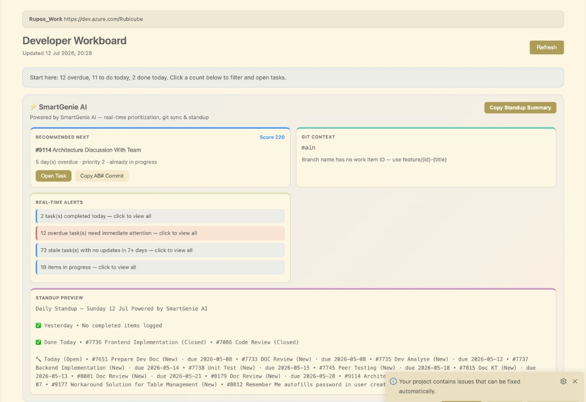
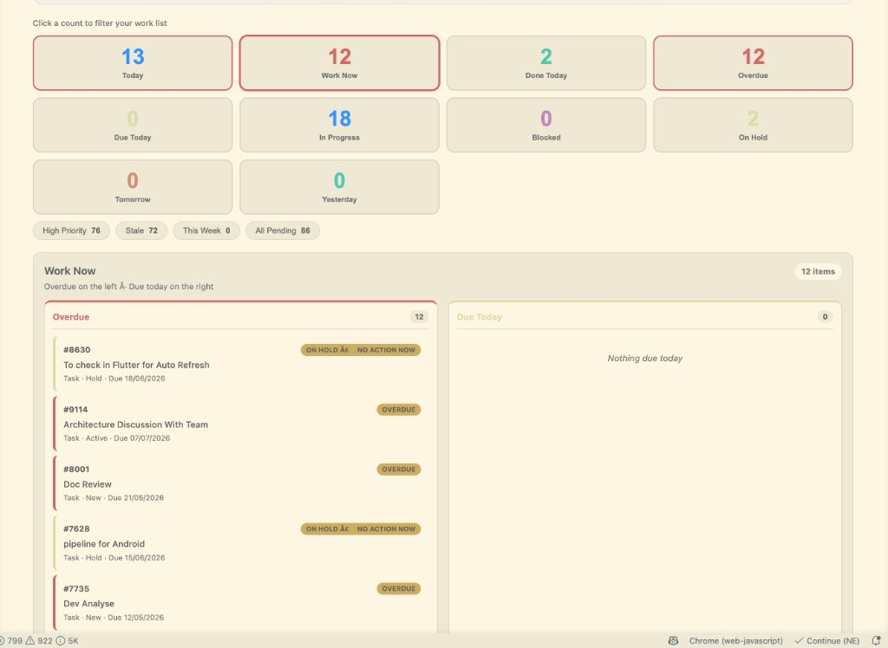
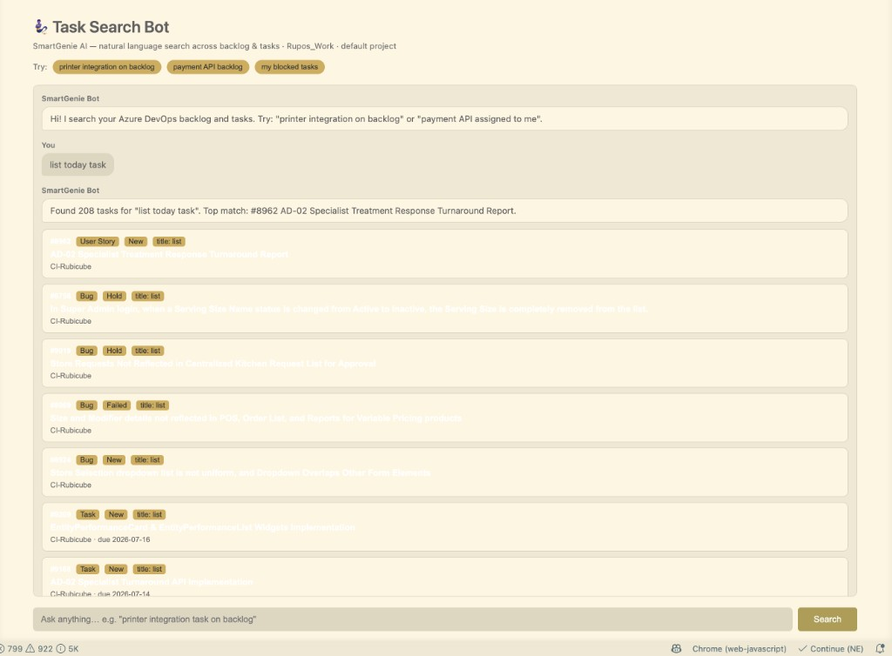
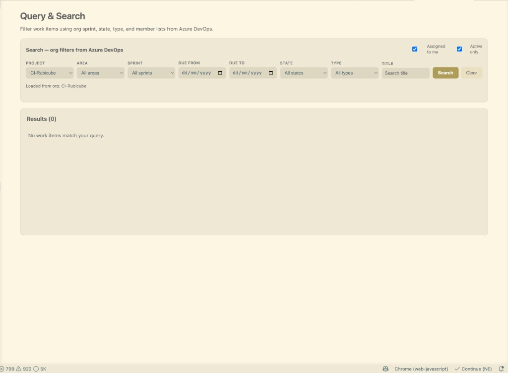
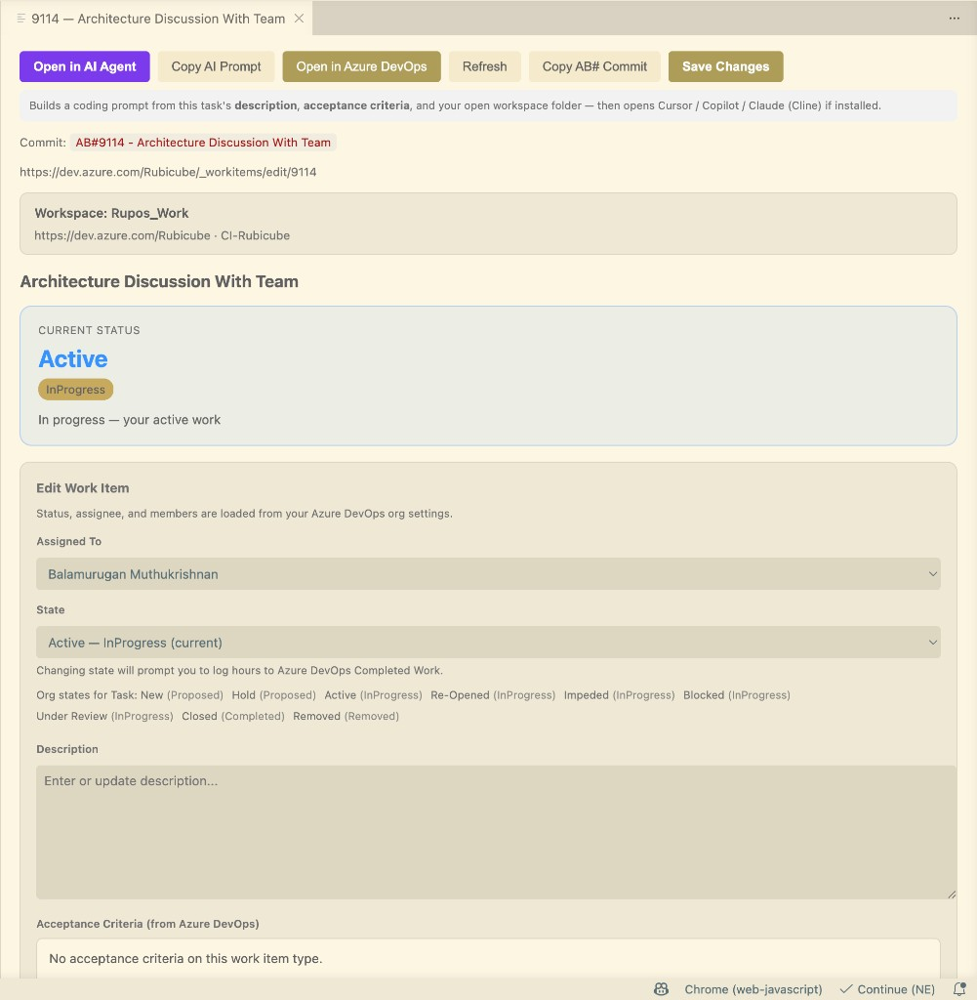

# RubiOps

**Publisher:** CIGlobalTechnologies · **Azure DevOps inside VS Code & Cursor**

RubiOps connects your editor to Azure DevOps so you can see tasks, update work items, run standups, search backlog in plain English, and send implementation prompts to **Cursor**, **Copilot**, or **Claude** — without leaving the IDE.

---

## Publisher & support

| | |
|---|---|
| **Developer** | Balamurugan |
| **Publisher** | CIGlobalTechnologies |
| **Email** | [messagetobalamurugan@gmail.com](mailto:messagetobalamurugan@gmail.com) |
| **WhatsApp** | [+91 7538886343](https://wa.me/917538886343) |
| **Marketplace** | [RubiOps](https://marketplace.visualstudio.com/items?itemName=CIGlobalTechnologies.rubiops) |

Questions, feedback, or support — email or WhatsApp anytime.

---

## All features

### Connection & workspace

- Connect to Azure DevOps with organization URL + Personal Access Token (PAT)
- Step-by-step connect wizard with **How to get PAT** button
- Onboarding guide on Dashboard when not connected
- Per-workspace-folder connection (different folders → different orgs)
- PAT stored in VS Code Secret Storage (encrypted)
- Clear error messages listing required PAT scopes

### Developer Workboard (Dashboard)

- Live work summary: overdue, due today, done today, in progress, blocked, on hold
- Clickable stat tiles — click any count to filter the list below
- Remembers your last selected filter across sessions
- **Work Now** split view: overdue (left) + due today (right)
- Filter chips: High Priority, Stale, This Week, All Pending
- Sprint progress charts — click bars to filter by type, state, sprint
- **Your Day at a Glance** — today / tomorrow strips
- Quick actions: open details, change state, copy standup, copy commit message
- Refresh all panels from sidebar title bar

### RubiOps assistant (on Dashboard)

- **Recommended next task** — scored by overdue, priority, due date, in-progress state
- **Git context** — current branch + linked work item ID from branch name
- **Real-time alerts** — done today, overdue, stale, in progress (click to filter)
- **Standup preview** — yesterday, done today, today open, blockers, in progress
- **Copy Standup Summary** to clipboard for daily meetings
- Focus mismatch warning when branch task ≠ recommended task

### My Tasks

- **Sidebar tree** — all active tasks assigned to you
- Click task → open full details
- Right-click → open details or change state
- **My Tasks panel** — scrollable list with select + open
- Refresh after connect, state change, or manual refresh

### Task Search Bot

- Natural language search across backlog and tasks
- Example: `printer integration on backlog`, `my blocked tasks`
- Searches title, description, and tags in Azure DevOps
- Understands backlog, assigned-to-me, blocked, in-progress intents
- Ranked results with match reasons
- Click any result → open work item details
- Quick-try example chips on the search page

### Query & Search

- Advanced filters loaded from your org: project, area, sprint, state, type
- Title search, due date range
- Assigned to me + active only toggles
- WIQL-backed search with result list
- Open any result in work item details

### Work item details

- View and edit state, assignee, description
- **Acceptance criteria** from Azure DevOps (read-only)
- Discussion comments — add new comments to the work item
- Org-valid state transitions only
- Open work item in Azure DevOps browser
- **Copy AB# commit message** (`AB#123 - title`)
- Activity audit comments on saves (attributed to RubiOps)

### AI implementation (task → code)

- **Open in AI Agent** — builds prompt from description + acceptance criteria + workspace folder
- **Copy AI Prompt** — same prompt to clipboard
- Auto-detects: Cursor Composer, GitHub Copilot Chat, VS Code Chat, Continue, Cline (Claude)
- Suggested branch name and commit message in the prompt
- Setting to choose preferred AI agent

### Time logging

- Prompt for hours when changing work item status
- Writes to Azure DevOps Completed Work / Remaining Work
- Settings: enable/disable, required vs optional, complete-only mode
- Graceful fallback when work item type does not support scheduling fields

### Git workflow

- Optional branch creation when moving to active/in-progress state
- Configurable branch pattern (`feature/{id}-{title}`)
- AB# commit message helper
- Open work item from git branch name (AB#123 in branch)

### Sidebar menu

- One-click access: Dashboard, My Tasks, Task Search Bot, Query & Search
- Connect, How to get PAT, Refresh
- First-time setup checklist when not connected

---

## Screenshots

### Developer Workboard — RubiOps panel

Recommended next task, git branch context, real-time alerts, and standup preview.

### Work Now — overdue & due today

Click stat tiles to filter. Split list shows overdue tasks on the left and due today on the right.

### Task Search Bot

Ask in plain English to find backlog items (e.g. printer integration, payment API, blocked tasks).

### Query & Search

Org-driven filters: project, area, sprint, state, type, title, and due dates.

### Work item details — Open in AI Agent

Send a coding prompt built from task description, acceptance criteria, and your open code folder to Cursor, Copilot, or Claude.

---

## Connect in 3 steps

1. **Open a project folder** (`File → Open Folder`)
2. **Create a PAT** at `https://dev.azure.com/YourOrg/_usersSettings/tokens`  
   Scopes: **Work Items** (Read & write), **Project and Team** (Read), **Member Entitlement** (Read)
3. Click **Connect Azure DevOps** → enter org URL, PAT, and project name (e.g. `MyProject`)

---

## Settings (Settings → RubiOps)

| Setting | Description |
|---------|-------------|
| `devopsQuickUpdate.organizationUrl` | Azure DevOps org URL |
| `devopsQuickUpdate.projectName` | Default project |
| `devopsQuickUpdate.timeLog.enabled` | Hours prompt on status change |
| `devopsQuickUpdate.timeLog.required` | Require hours (`false` = skip) |
| `devopsQuickUpdate.timeLog.onCompleteOnly` | Prompt only when completing |
| `devopsQuickUpdate.ai.preferredAgent` | `auto`, `cursor`, `copilot`, `cline`, `copy` |
| `devopsQuickUpdate.git.createBranchOnActiveState` | Branch on active state |
| `devopsQuickUpdate.git.branchPattern` | `feature/{id}-{title}` |

---

## Commands

| Command | Description |
|---------|-------------|
| Connect Azure DevOps | Connect wizard |
| Open Dashboard | Developer Workboard |
| Open My Tasks | Task list panel |
| Focus My Tasks Sidebar | Sidebar tree |
| Open Task Search Bot | Natural language search |
| Open Query & Search | Advanced filters |
| Open Task in AI Agent | Send prompt to AI |
| Copy AI Implementation Prompt | Copy prompt |
| Copy Standup Summary (AI) | Standup to clipboard |
| Open AI Recommended Task | Top priority task |
| Copy Commit Message (AB#) | Git commit format |
| Change State | Workflow transition |
| Refresh All | Reload everything |

---

## Requirements

- VS Code **1.85+** or **Cursor**
- Azure DevOps organization + PAT
- Git extension (built-in) for branch features

---

## Privacy

- Credentials stay on your machine (Secret Storage)
- Data goes only to your Azure DevOps org
- No third-party analytics server

---

## Publisher & contact

**Balamurugan** · Publisher: **CIGlobalTechnologies**

- **Email:** [messagetobalamurugan@gmail.com](mailto:messagetobalamurugan@gmail.com)
- **WhatsApp:** [+91 7538886343](https://wa.me/917538886343)
- **Marketplace:** [RubiOps](https://marketplace.visualstudio.com/items?itemName=CIGlobalTechnologies.rubiops)

---

## License

MIT — LICENSE file included in the extension package.
